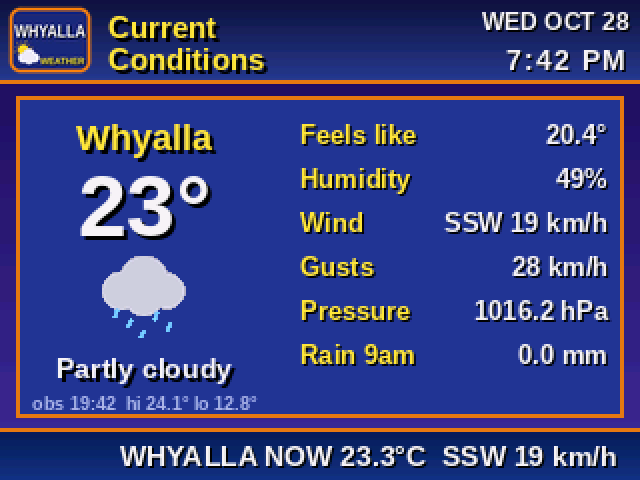
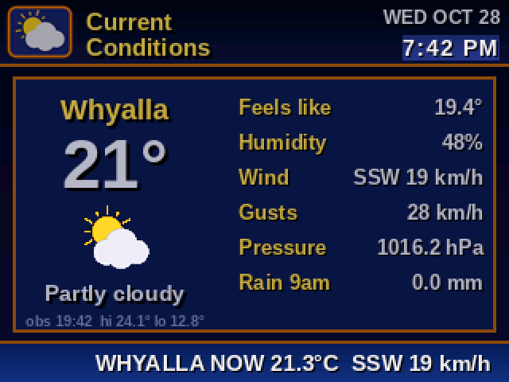
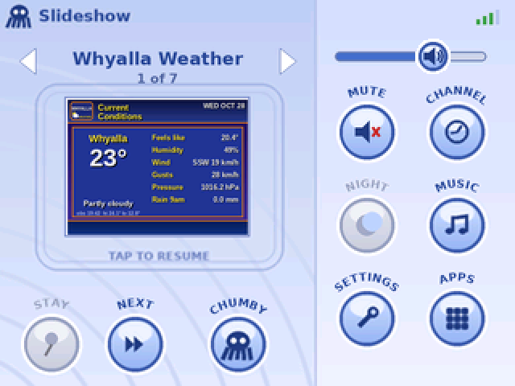

# neochumby-classic

The classic Chumby experience for [neochumby](https://github.com/johnmerchant/neochumby):
a 90s weather channel, ABC News, stock quotes, your photos and a Vista-style aurora
screensaver, with Home, Settings and Music screens, and a "my channels" web page modelled
on chumby.com's.

The Chumby (a 266 MHz ARM with no FPU) only copies pictures to its screen. Everything hard
(fetching, parsing, fonts, layout) happens here, on the server beside neochumbyd: this
program draws every page and screen ahead of time, for each paired Chumby, every ten
minutes.

| | | |
| --- | --- | --- |
|  |  |  |
|  |  |  |
|  |  |  |

The screenshots come from the smoke test (`tests/smoke.py --screenshots`): made-up data
and the placeholder pictures this repository ships, put together as the Chumby draws them.

## How it fits with neochumby

```
 this repository (Python)                         neochumby (Rust)
 ┌──────────────────────────────┐                 ┌───────────────────────────────┐
 │ neochumby-classic-renderer   │  writes         │ a companion reads each        │
 │   every 10 min, and on       ├──────────────►  │ Chumby's directory and        │
 │   request, per paired Chumby │  out/<chumby>/  │ delivers it (NFS or sync)     │
 │                              │                 │                               │
 │ neochumby-classic-web        │  admin socket   │ neochumbyd: pairing, each     │
 │   "my channels", pairing,    ├──────────────►  │ Chumby's start= and delivery= │
 │   start app, delivery        │                 │                               │
 └──────────────────────────────┘                 │ on the Chumby: the classic    │
                                                  │ app draws the pictures        │
                                                  └───────────────────────────────┘
```

- **The renderer** writes each Chumby's pictures into `out/<chumby>/`: `manifest.txt`,
  RGB565 files, `hashes.txt` and a `version` marker written last.
  [docs/interface.md](docs/interface.md) is the exact contract a neochumby companion reads.
- **The web page** edits the channel (which apps, in what order, their options), and,
  after you sign in with the server owner's token, approves pairings and sets each
  Chumby's start app and delivery. It talks to neochumbyd only through neochumbyd's admin
  socket. It offers as start apps only the apps whose manifest says `start = true`; pick
  `classic` to have a Chumby start in this experience.
- Nothing in neochumby starts this program, and nothing here starts neochumbyd. They run
  side by side on the same server.

## Install

You need a Linux server running neochumbyd (with systemd), and Python 3.11 or newer with
its `venv` module (Debian: `apt install python3 python3-venv`).

```sh
git clone https://github.com/phoozle/neochumby-classic
cd neochumby-classic
sudo ./install.sh            # add --heif to accept iPhone HEIC photos
```

`install.sh`:

1. creates the user `neochumby-classic` and adds it to neochumbyd's group (`neochumbyd`;
   `--group` to change), so the renders are readable by neochumbyd's companion;
2. makes a venv in `/opt/neochumby-classic` and installs this package into it;
3. asks **once** for the server owner's token (`neochumbyd token` prints it), checks it with
   neochumbyd, and keeps it root-only in `/etc/neochumby-classic/owner-token`;
4. writes and starts two systemd services, `neochumby-classic-renderer` and
   `neochumby-classic-web`, with their settings in `/etc/neochumby-classic/env`.

Then open `http://<server>:8080/` on your phone or computer. Under **Chumby settings**, set
the address the Chumby's QR code should show, your time zone and your latitude and
longitude (for night mode); under the Weather app's **customize**, your place.

Re-run `install.sh` to upgrade (after `git pull`) or to change an option (`--help` lists
them); it keeps the settings it was given before. `sudo ./install.sh --token` stores a new
owner token after `neochumbyd token new`. `sudo ./install.sh --uninstall` removes the
services, the venv and the settings but keeps your config, photos, renders and assets;
add `--purge` to remove those and the user too. It never installs or changes neochumbyd.

**The admin socket and the dedicated user.** neochumbyd's admin socket (neochumby PR #9)
answers only neochumbyd's own user and root. Until it also lets its group in, the
`neochumby-classic` user can't use it: install.sh says so at the end. Then either run the
services as neochumbyd's user (`sudo ./install.sh --user neochumbyd`), or list the Chumbys
to render in `/etc/neochumby-classic/env` (`NEOCHUMBY_CLASSIC_CHUMBYS="kitchen lounge"`);
the web page's Chumbys page needs the socket either way.

**With Docker** instead: see [docker-compose.yml](docker-compose.yml). Both containers run
as neochumbyd's user.

### Settings

`/etc/neochumby-classic/env` (install.sh writes it), or the environment:

| Variable | Default | |
| --- | --- | --- |
| `NEOCHUMBY_CLASSIC_STATE` | `/var/lib/neochumby-classic` | config.json, photos, caches, `refresh/`, `info/` |
| `NEOCHUMBY_CLASSIC_OUT` | `$STATE/out` | the renders, one directory per Chumby |
| `NEOCHUMBY_CLASSIC_ADMIN` | `/var/lib/neochumbyd/admin.sock` | neochumbyd's admin socket |
| `NEOCHUMBY_CLASSIC_TREE` | `/var/lib/neochumbyd/tree` | neochumbyd's app tree (for the start-app list) |
| `NEOCHUMBY_CLASSIC_WEB` | `0.0.0.0:8080` | where the web page listens |
| `NEOCHUMBY_CLASSIC_EVERY` | `600` | seconds between renders (at least 60) |
| `NEOCHUMBY_CLASSIC_CHUMBYS` | (ask neochumbyd) | the Chumbys to render, if not the paired ones |
| `NEOCHUMBY_CLASSIC_ASSETS` | `/etc/neochumby-classic/assets` | your own pictures (below) |
| `NEOCHUMBY_CLASSIC_CONFIG` | `$STATE/config.json` | the channel settings the web page writes |

## The original logo and footage

This repository's code contains none of the original artwork: no Chumby logo or octopus,
no broadcaster's or company's logos, no video. Each widget draws a placeholder instead.

The originals are available separately, from
[phoozle/neochumby-classic-assets](https://github.com/phoozle/neochumby-classic-assets).
**They are not covered by this repository's MIT licence.** Each file belongs to its owner,
as that repository's README says, so check it before you use them. To use them on your
server:

```sh
sudo ./install.sh --assets          # clones it into /etc/neochumby-classic/assets, or pulls it
```

or by hand:

```sh
sudo git clone https://github.com/phoozle/neochumby-classic-assets /etc/neochumby-classic/assets
```

install.sh remembers `--assets` and pulls again whenever it is re-run. `--assets URL` takes
another repository (your own copies, say), and `--uninstall --purge` removes the directory.
They replace the placeholders at the next render.

You can also use pictures of your own: put them in `/etc/neochumby-classic/assets/`
(`NEOCHUMBY_CLASSIC_ASSETS`), readable by the service user, under these names:

| File | Used for | Without it |
| --- | --- | --- |
| `logo.png` | the aurora's logo (RGBA, about 220 × 64) | a "neochumby" wordmark |
| `octopus.png` | the mark on Home, Settings and the leave dialog (RGBA) | a drawn octopus |
| `weather-badge.png` | the weather pages' badge, top left (RGBA) | a drawn sun and cloud |
| `raysclip.png` | the aurora's light rays | no rays |
| `abc-logo.png`, `abc-swirls.png` | the news header | a plain NEWS mark |

- `raysclip.png` is made from a video with [`tools/raysclip.py`](tools/raysclip.py)
  (needs ffmpeg and numpy).
- The news header's two files can be cut from a banner with
  `python -m neochumby_classic.widgets.news assets BANNER.png DIR`.
- Keep pictures like these out of any fork of this repository you publish
  (`private-assets/` is in `.gitignore` for that).

## Data sources: terms to check

The widgets fetch from these sources. Check each one's terms before you use this beyond
your own home, and certainly before anyone redistributes what it draws.

| Source | Used by | To check |
| --- | --- | --- |
| Bureau of Meteorology, anonymous FTP (`ftp.bom.gov.au/anon/gen/fwo/`) | Weather, the ticker | BOM's copyright and data terms for display and redistribution. Its website blocks scrapers; the FTP products are the sanctioned route |
| ABC News RSS, and ABC article pages (`abc.net.au`) | News, the ticker | ABC's RSS terms (personal, non-commercial use). The Eyre Peninsula page and the article bodies are **scraped**, which the terms may not allow |
| Yahoo Finance's chart endpoint (`query1.finance.yahoo.com/v8/finance/chart`) | Stocks | Unofficial and undocumented. Yahoo's terms allow personal use, not redistribution |
| financialmodelingprep.com, assets.parqet.com | Stock logos | Unofficial. The logos are the companies' trademarks; they are fetched and cached on your server, never committed |
| SomaFM's API and streams | Music | SomaFM's terms for its API and channel artwork |

The weather defaults to Whyalla, South Australia, only as an example.

## Widgets

The five widgets are plugins, found through Python entry points, exactly as a widget from
another repository would be. [docs/widgets.md](docs/widgets.md) is the widget API
(version 1): what a widget declares, what it may draw, the rules that keep the Chumby fast
(stable names, write only what changed, no per-render times, a memory budget per page,
the engine's limits), and how to publish one in its own repository and install it pinned
to a commit (`sudo ./install.sh --widget git+https://...@<commit>`).

## Development

```sh
python3 -m venv .venv && .venv/bin/pip install -e ".[dev]"
.venv/bin/ruff check .
.venv/bin/python tests/smoke.py --screenshots docs/screenshots
```

The smoke test renders every widget offline with made-up data (`tests/fakenet.py`), checks
the output against [docs/interface.md](docs/interface.md), checks that a second render
writes nothing, and drives the web page against a stand-in for neochumbyd's admin socket.
`python -m neochumby_classic.preview OUT page 0 page.png` puts one page together as the
Chumby would show it. CI runs all of this, the install script on a real systemd, and the
Docker build.

[docs/packaging.md](docs/packaging.md) describes how this may also become a neochumby app
crate.

## Licence

MIT: see [LICENSE](LICENSE). The bundled fonts keep their own licences, which are next to
them in [`files/python/neochumby_classic/data/fonts/`](files/python/neochumby_classic/data/fonts/).
